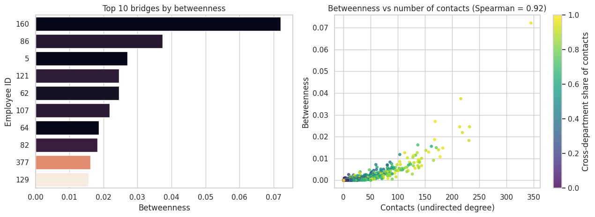
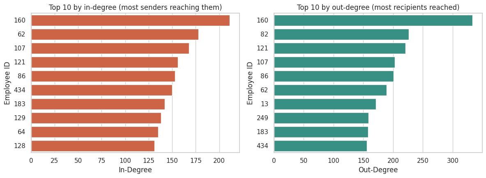
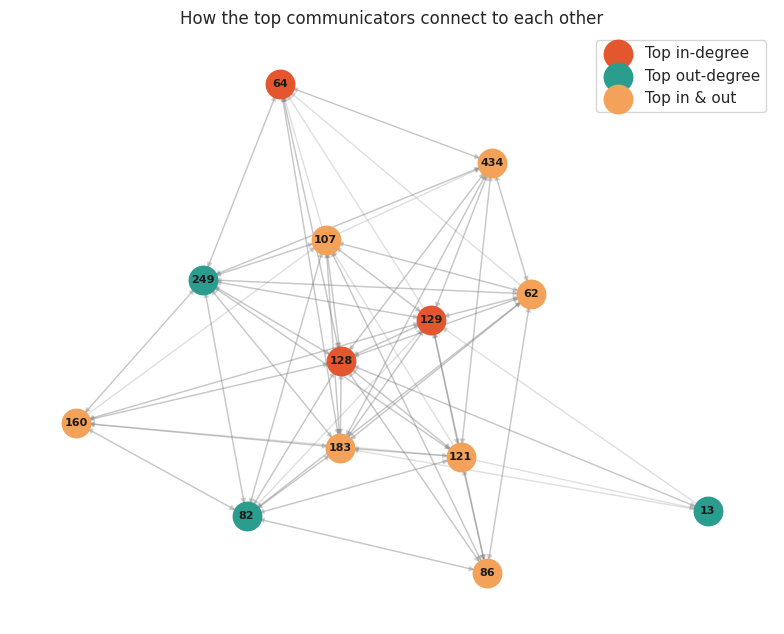
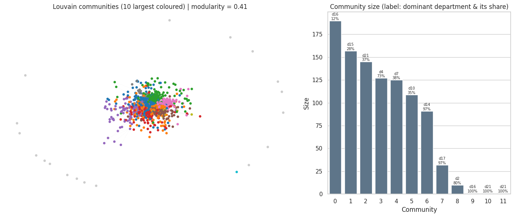
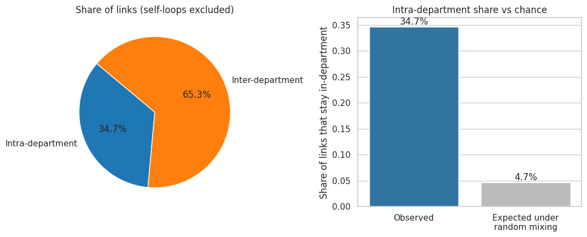
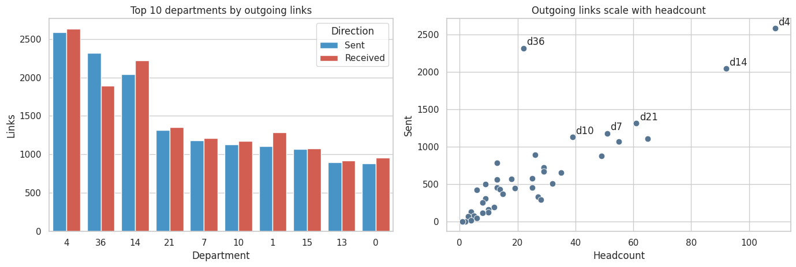
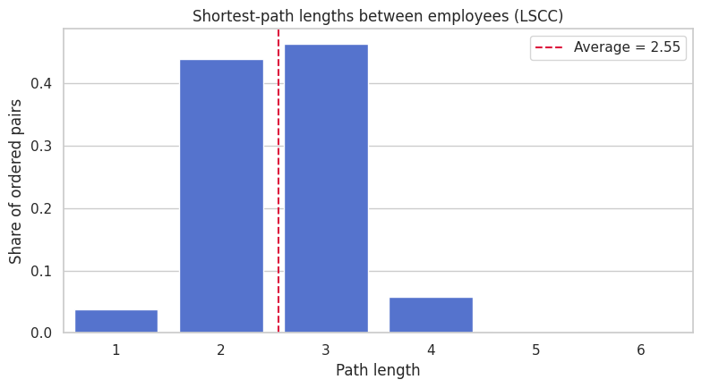
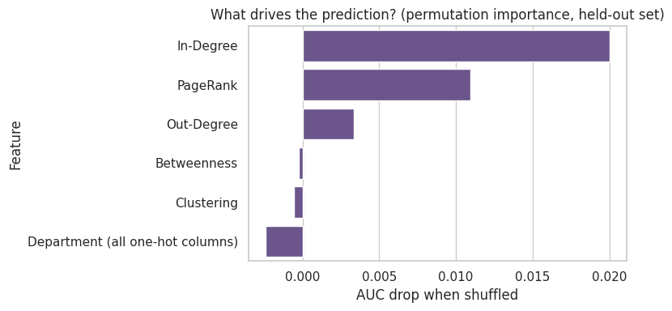
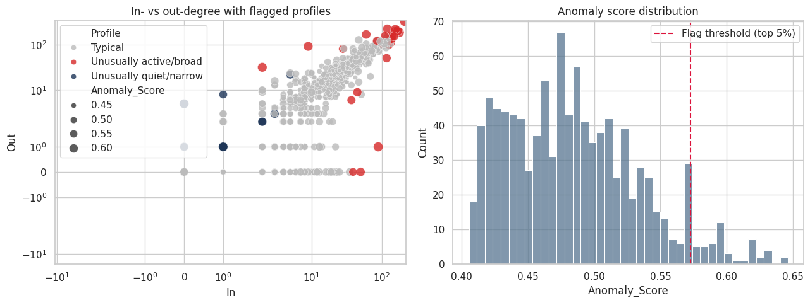

# Organizational Network Intelligence

Using Python, I analysed the internal email network of a large European research institution (1,005 employees and 25,571 directed email links) to find out who the key communicators are, how the organisation clusters, and where information flows or gets stuck. I built the network with NetworkX, measured it with centrality, community-detection, shortest-path, machine-learning and anomaly-detection methods, and tested whether the org chart matches how people actually communicate. The main finding is that **a small group in Department 36, only 22 of 1,005 people, sits at the centre of the network**: it holds the top five receivers of email and six of the top ten bridges between groups.

## Table of Contents

- [Dashboard Preview](#dashboard-preview)
- [Introduction](#introduction)
- [Data Overview and Dataset Structure](#data-overview-and-dataset-structure)
- [Data Cleaning and Preparation](#data-cleaning-and-preparation)
- [Analysis and Findings](#analysis-and-findings)
- [Conclusion](#conclusion)
- [Recommendations](#recommendations)
- [Assumptions and Limitations](#assumptions-and-limitations)
- [Tools and Repository Structure](#tools-and-repository-structure)

## Dashboard Preview



*Employee 160 is the biggest bridge by a wide margin, and almost all of the top bridges contact people outside their own department.*

## Introduction

An organisation needs to know who its people rely on to get things done. Without that view, key communicators and the people who connect departments go unnoticed, and silos form without anyone seeing them.

This project analyses the SNAP `email-Eu-core` network using Python to answer practical questions about communication. The analysis aims to:

- Identify the key communicators by emails received and sent.
- Detect communities and test whether they match departments.
- Measure how much communication stays within departments and how much crosses them.
- Measure how efficiently information travels through the network.
- Test whether future key communicators can be predicted.
- Find the people who bridge groups and the people with unusual email behaviour.

## Data Overview and Dataset Structure

The data comes from [SNAP](https://snap.stanford.edu/data/email-Eu-core.html) (see that page for the dataset citation) and has two files. The network has **1,005 employees** and **25,571 directed links** across **42 departments**, with a density of 0.0253, so only about 2.5% of all possible connections are used.

A link `u -> v` means *u sent v at least one email*, so links are unique sender-receiver pairs, not a count of emails.

| File | Column | Description |
|---|---|---|
| email-Eu-core | Sender | ID of the employee who sent at least one email |
| email-Eu-core | Receiver | ID of the employee who received it |
| email-Eu-core-department-labels | Node | Employee ID |
| email-Eu-core-department-labels | Department | Department the employee belongs to (0 to 41) |

## Data Cleaning and Preparation

| Issue | Treatment |
|---|---|
| Missing values | None found in either file |
| Duplicate sender-receiver rows | None found |
| 642 self-loops (people emailing themselves) | Removed from network metrics, leaving 24,929 links. The intra-department share is reported both with and without them |
| Data types | Checked, all integer IDs, no changes needed |

The cleaned network has 20 weakly connected components, and the largest strongly connected component holds 803 people. Shortest-path results use that component. All other metrics use the full cleaned network.

## Analysis and Findings

### 1. Key Communicators

*In-degree* is the number of different people who emailed someone; *out-degree* is the number of different people they emailed. Both are measured on the full network. The median employee has an in-degree of 17 and an out-degree of 14.

| Rank | Top in-degree (employee, dept, value) | Top out-degree (employee, dept, value) |
|---|---|---|
| 1 | 160, dept 36, 211 | 160, dept 36, 333 |
| 2 | 62, dept 36, 178 | 82, dept 36, 226 |
| 3 | 107, dept 36, 168 | 121, dept 36, 221 |
| 4 | 121, dept 36, 156 | 107, dept 36, 203 |
| 5 | 86, dept 36, 153 | 86, dept 36, 201 |

Employee 160 leads both lists, receiving from about 12 times and emailing about 24 times as many people as the median employee. Seven employees (62, 86, 107, 121, 160, 183 and 434) appear in both top-10 lists, and in-degree and out-degree are strongly linked (Spearman 0.90), so heavy receivers are also heavy senders. All of the top five in each list are in Department 36.





### 2. Communities

Louvain detection found **28 communities** with a modularity of **0.41**, which means the network has clear group structure. Seven large communities of 91 to 190 people cover 944 of the 1,005 employees. Agreement with the department labels is moderate (NMI 0.60, ARI 0.35), and **43.7%** of links run between communities.

Only a few communities line up with one department. Community 6 is 97% Department 14 and community 7 is 97% Department 17, and community 3 is 73% Department 4. The largest community (190 people) is a mix, with no department above 12%. So the communication groups partly follow the org chart and partly cut across it.



### 3. Within Departments or Across Them

| Measure | Share of links |
|---|---|
| Intra-department (including self-loops) | 36.3% (9,287 links) |
| Intra-department (excluding self-loops) | 34.7% |
| Expected if links were placed between random pairs | 4.7% |

Most links (about 65%) cross departments, so this is a cross-functional organisation. But people still talk inside their own department about **7 times more** than chance would give, so departments do matter.



### 4. Department Activity

| Department | Headcount | Sent | Received | Sent per person |
|---|---|---|---|---|
| 4 | 109 | 2,584 | 2,632 | 23.7 |
| 36 | 22 | 2,318 | 1,889 | 105.4 |
| 14 | 92 | 2,044 | 2,217 | 22.2 |
| 21 | 61 | 1,315 | 1,356 | 21.6 |
| 7 | 51 | 1,182 | 1,212 | 23.2 |

Department 4 sends the most links in total, but it is also the largest. Department 36 stands out: with just 22 people it sends 2,318 links, about 105 per person against 17 to 35 for the other top departments, and it sends 429 more links than it receives. Departments 14 and 1 receive more than they send. Outside Department 36, activity mostly follows headcount.



### 5. Information Flow

The largest strongly connected component holds **803 people (79.9% of the network)**. The average shortest path is **2.55** steps and the diameter is **6**. About **94.1%** of pairs can reach each other within 3 hops, and 3.7% of pairs are direct contacts.

Information reaches almost anyone in two or three steps, so the network is efficient. The long paths of 5 to 6 steps involve very few pairs.



### 6. Predicting Key Communicators

There are no timestamps, so I used a link-holdout test: features come from 70% of links, and the target is being in the top 10% by in-degree (105 of 1,005 employees) in the other 30%.

| Model | ROC AUC | Average precision |
|---|---|---|
| Baseline: logistic on in-degree only | 0.982 | 0.884 |
| Random forest: department only | 0.625 | 0.239 |
| Random forest: network features | 0.968 | 0.848 |
| Random forest: network + department | 0.979 | 0.883 |

Past in-degree is by far the best predictor. A random forest with all features does not beat the one-feature baseline (0.979 against 0.982). Department alone is only slightly better than guessing and adds nothing once network features are included. Permutation importance agrees: in-degree (0.020 AUC drop) and PageRank (0.011) matter, while department, betweenness and clustering do not.



### 7. Bridges

| Employee | Department | Betweenness | Contacts | Cross-department share |
|---|---|---|---|---|
| 160 | 36 | 0.072 | 345 | 96.8% |
| 86 | 36 | 0.037 | 216 | 93.5% |
| 5 | 25 | 0.027 | 169 | 97.0% |
| 121 | 36 | 0.025 | 232 | 92.7% |
| 62 | 36 | 0.025 | 214 | 95.3% |

Employee 160 has almost twice the betweenness of the next bridge. Six of the top ten bridges are in Department 36 and two (5 and 64) are in Department 25. Each of the top eight has more than 90% of contacts outside their own department and reaches 31 to 39 of the 42 departments. Betweenness tracks the number of contacts closely (Spearman 0.92), and 8 of the top 10 bridges are also in the top 10 by total degree, so the best-connected people are also the ones the network depends on. The network has 73 articulation points, people whose removal cuts someone off from the rest.


### 8. Unusual Email Behaviour

Isolation Forest flagged **51 employees** (the top 5% most unusual profiles): 26 unusually active or broad and 25 unusually quiet or narrow.

- **Unusually active:** the top communicators 160, 107, 62 and 121 are flagged simply for being so connected. Employee 564 (2 in, 32 out) and 971 (9 in, 93 out) send widely but receive almost nothing, which looks like broadcast or announcement behaviour. Employee 365 receives from 89 people but sends to only 1.
- **Unusually quiet:** employees 763 and 837 have a single sender and a single recipient, and 979 emails 5 people but receives nothing.

A flag is a lead to look at, not evidence of a problem. Most are explained by role.



## Conclusion

The organisation is well connected: information travels in about 2.5 steps, most communication crosses departments, and the network has clear group structure. But the connections are concentrated in a few people.

- **Key communicators:** Employee 160 and four colleagues in Department 36 receive and send more than anyone else.
- **Communities:** 28 communities (7 large) partly follow departments but also cut across them (NMI 0.60).
- **Departments:** 65% of links cross departments, yet staying in-department is about 7 times more common than chance.
- **Information flow:** the average path is 2.55 steps, and 94% of pairs are within 3 hops.
- **Prediction:** past in-degree predicts future key communicators far better than department does.
- **Bridges and anomalies:** the main bridges are the same people as the main communicators, and most flagged profiles are explained by their role.

Overall, **a small, highly connected core in Department 36 carries a large share of the organisation's communication**.

## Recommendations

1. **Use the key communicators for announcements and knowledge sharing.** Employees 160, 62, 107, 121 and 86 reach the most people, so they are the fastest route for organisation-wide messages.
2. **Reduce reliance on a few bridges.** Employee 160 carries nearly twice the bridging load of anyone else, and Department 36 holds most of the top bridges. Document what they connect and build second links so communication does not depend on them.
3. **Look at Department 36's workload.** Twenty-two people send about 105 links each, several times the norm, which is worth checking for overload.
4. **Review flagged profiles for a business explanation first.** Check whether 365 is a shared mailbox or list, whether 564 and 971 are broadcasters, and whether the very quiet employees such as 763, 837 and 979 are inactive accounts or people who need to be brought into communication.
5. **Add timestamps and message volumes.** Prediction and anomaly detection would be far stronger with dates and message counts.

## Assumptions and Limitations

- The data is a public research dataset, not a live company system.
- It is a single snapshot with no timestamps, so changes over time cannot be analysed.
- Links record at least one email, so message volume and content are unknown.
- Department is one flat label, with no seniority or role information.
- Anomalies are statistical outliers, not evidence of wrongdoing.
- The prediction test is a proxy for "becoming" a key communicator, since true future behaviour is not observed.
- Community detection and the link-holdout split use a fixed random seed (42), so exact values can shift slightly with a different seed.

## Tools and Repository Structure

**Tools:** Python, Pandas, NetworkX, scikit-learn, Matplotlib, Seaborn, SciPy, Google Colab.

```
.
├── README.md
├── requirements.txt
├── Organizational_Network_Intelligence.ipynb   # analysis notebook (with outputs)
├── network_analysis.py                         # same analysis as a script
├── data/                                       # downloaded on first run (git-ignored)
├── images/                                     # chart images used in this README
└── outputs/
    └── results_summary.md                      # headline numbers
```

## Author

Aisha Hamza | [LinkedIn](https://www.linkedin.com/in/aisha-hamza-a21188187/) | [Email](mailto:hamzaaisha798@gmail.com)
